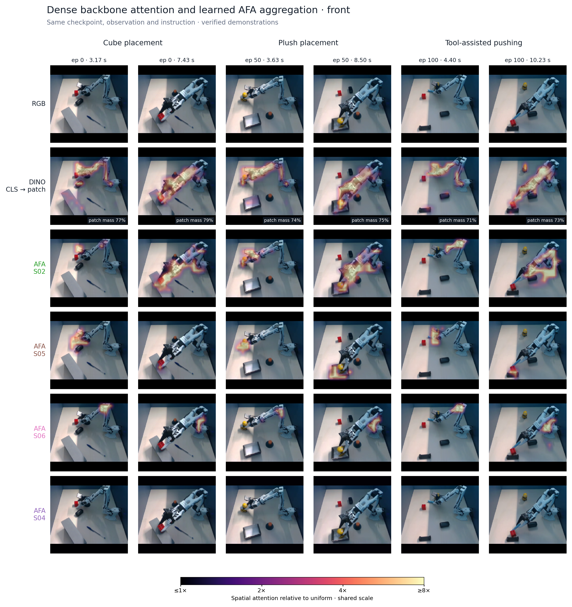
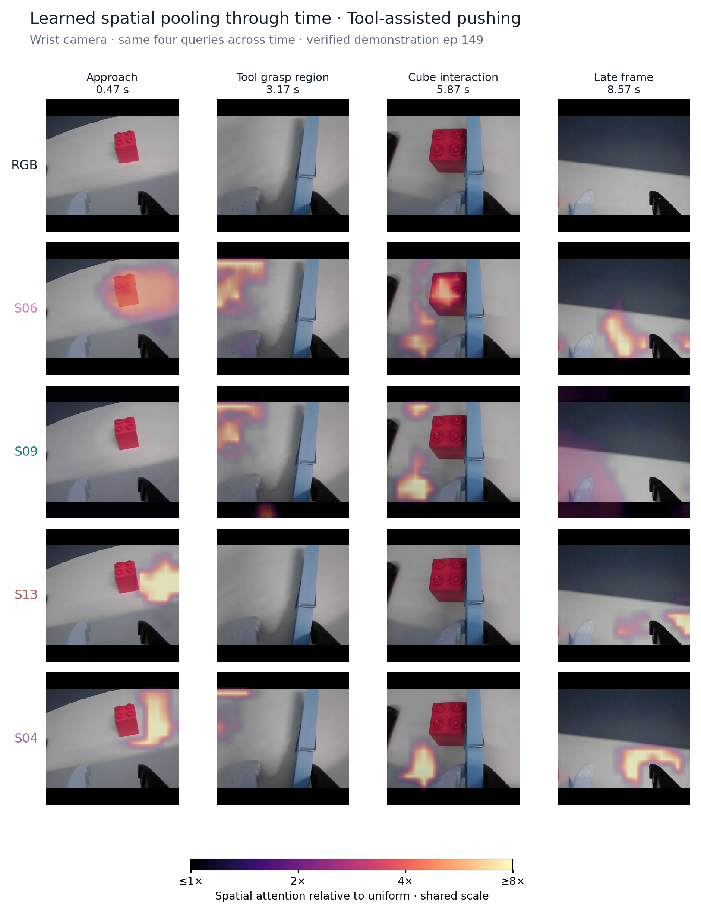
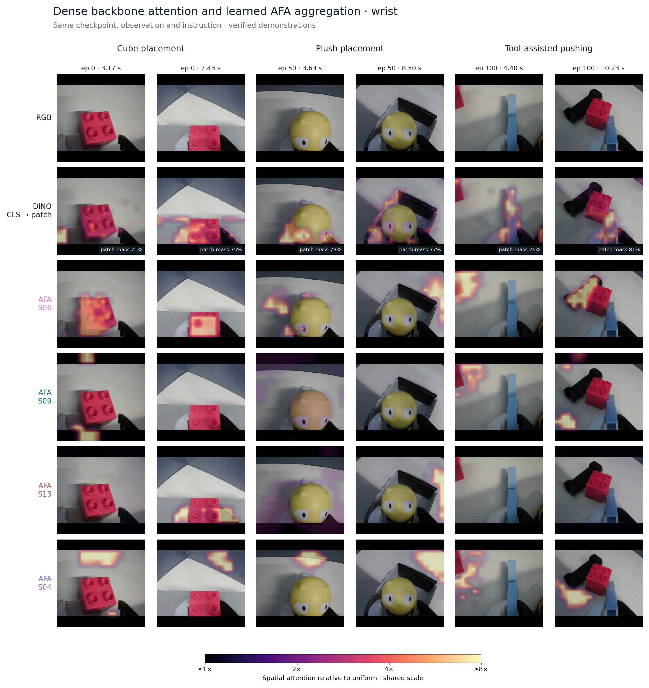
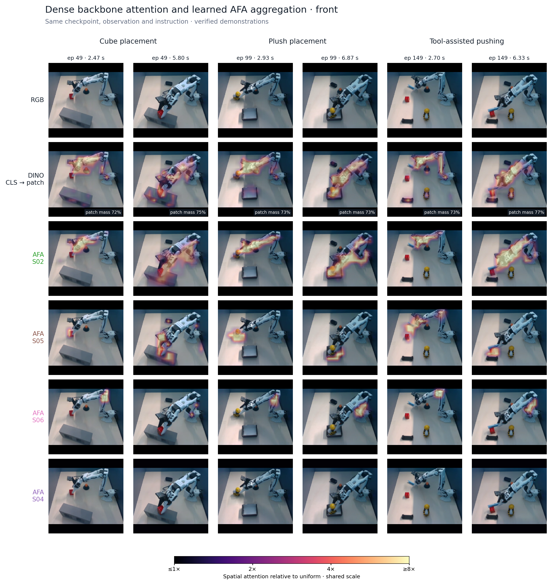
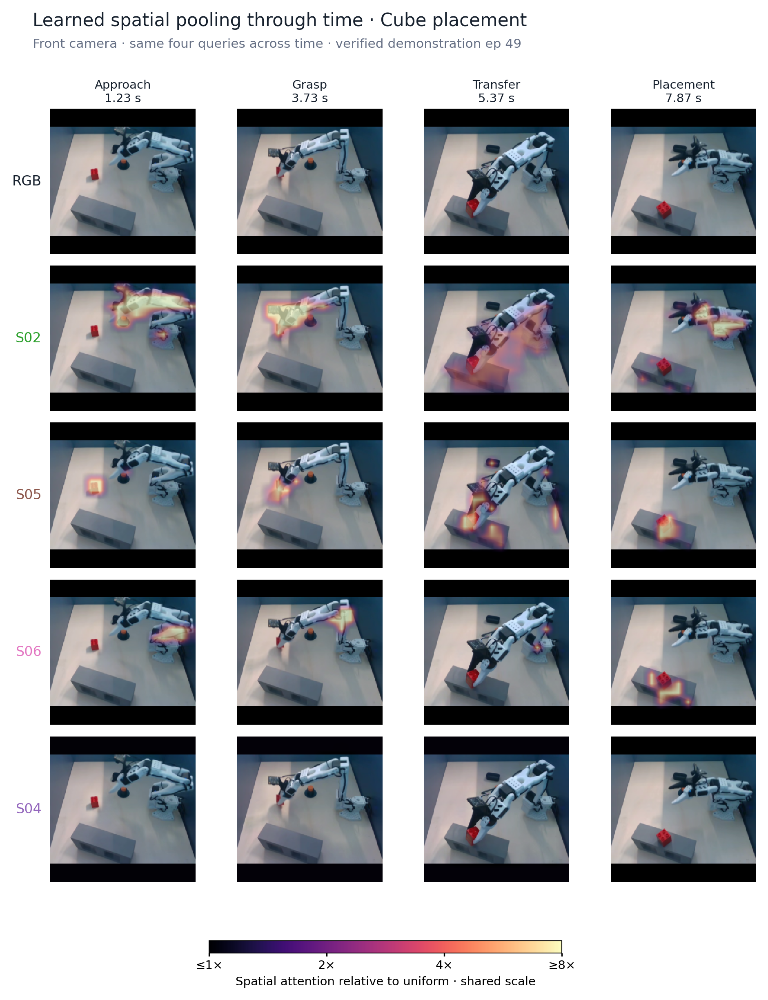
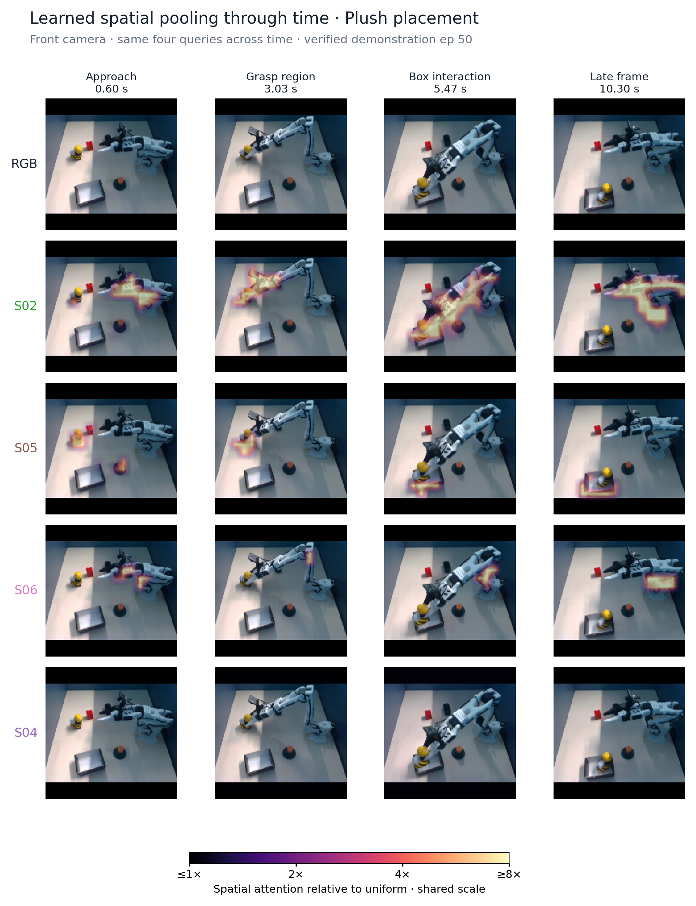
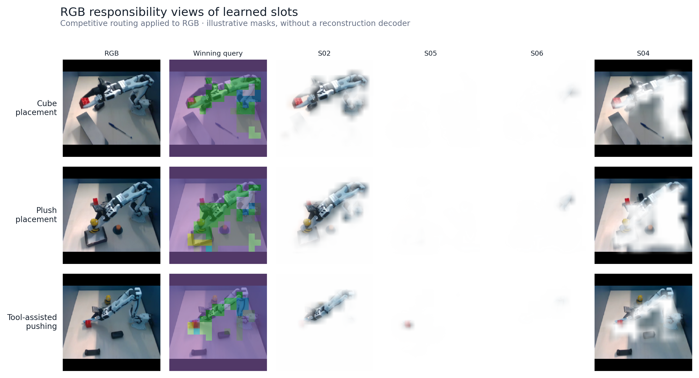
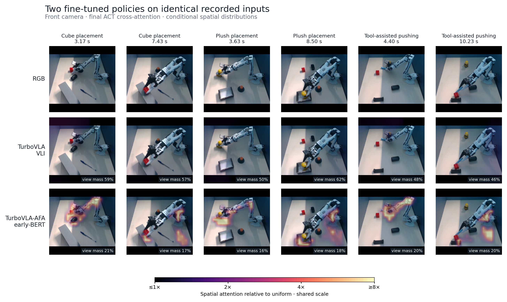
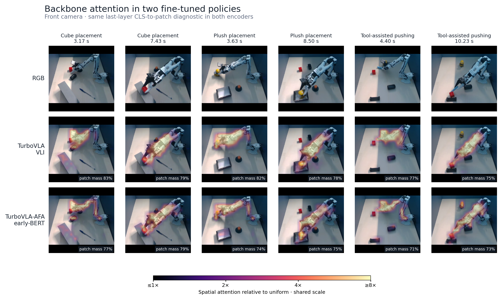

# Paper-style qualitative figures

Two main-text candidates; supporting comparisons in the appendix.

## Main

### M01_dino_to_afa

[PDF](main/M01_dino_to_afa.pdf) · [PNG](main/M01_dino_to_afa.png)

Front camera: last-layer DINO CLS-to-patch attention and four AFA spatial pooling maps from the same fine-tuned early-BERT checkpoint. Each column uses the same input in every row. The two observations per task are at 30% and 70% of an episode; they are not phase annotations. CLS attention is averaged across heads, CLS/register keys are excluded, and the remaining patch weights are normalized spatially. Every map uses the same attention-relative-to-uniform scale, with values at/below uniform transparent and values above 8× saturated. The fixed slot IDs illustrate different aggregation patterns; they do not denote object categories. This is a within-checkpoint representation diagnostic, not a comparison of policy success or a causal saliency analysis.

### M02_token_attention_through_time

[PDF](main/M02_token_attention_through_time.pdf) · [PNG](main/M02_token_attention_through_time.png)

Temporal visualization of four fixed wrist AFA queries, before the AFA transformer. The top row shows RGB; following rows show per-query spatial pooling distributions. Frames were selected by inspecting RGB interactions, independently of DINO CLS attention. Stage labels are descriptive readings of the images, not ground-truth phase annotations. The same slot IDs and attention scale are retained at every time step, including diffuse or redundant behavior. Stable query identity does not establish object tracking. The demonstration is a recorded training example, not a measured closed-loop success of the policy.

## Appendix

### A01_dino_to_afa_wrist

[PDF](appendix/A01_dino_to_afa_wrist.pdf) · [PNG](appendix/A01_dino_to_afa_wrist.png)

Wrist camera: last-layer DINO CLS-to-patch attention and four AFA spatial pooling maps from the same fine-tuned early-BERT checkpoint. Each column uses the same input in every row. The two observations per task are at 30% and 70% of an episode; they are not phase annotations. CLS attention is averaged across heads, CLS/register keys are excluded, and the remaining patch weights are normalized spatially. Every map uses the same attention-relative-to-uniform scale, with values at/below uniform transparent and values above 8× saturated. The fixed slot IDs illustrate different aggregation patterns; they do not denote object categories. This is a within-checkpoint representation diagnostic, not a comparison of policy success or a causal saliency analysis.

### A02_dino_to_afa_second_episodes

[PDF](appendix/A02_dino_to_afa_second_episodes.pdf) · [PNG](appendix/A02_dino_to_afa_second_episodes.png)

Front camera: last-layer DINO CLS-to-patch attention and four AFA spatial pooling maps from the same fine-tuned early-BERT checkpoint. Each column uses the same input in every row. The two observations per task are at 30% and 70% of an episode; they are not phase annotations. CLS attention is averaged across heads, CLS/register keys are excluded, and the remaining patch weights are normalized spatially. Every map uses the same attention-relative-to-uniform scale, with values at/below uniform transparent and values above 8× saturated. The fixed slot IDs illustrate different aggregation patterns; they do not denote object categories. This is a within-checkpoint representation diagnostic, not a comparison of policy success or a causal saliency analysis.

### A03_cube_temporal_attention

[PDF](appendix/A03_cube_temporal_attention.pdf) · [PNG](appendix/A03_cube_temporal_attention.png)

Temporal visualization of four fixed front AFA queries, before the AFA transformer. The top row shows RGB; following rows show per-query spatial pooling distributions. Frames were selected by inspecting RGB interactions, independently of DINO CLS attention. Stage labels are descriptive readings of the images, not ground-truth phase annotations. The same slot IDs and attention scale are retained at every time step, including diffuse or redundant behavior. Stable query identity does not establish object tracking. The demonstration is a recorded training example, not a measured closed-loop success of the policy.

### A04_plush_temporal_attention

[PDF](appendix/A04_plush_temporal_attention.pdf) · [PNG](appendix/A04_plush_temporal_attention.png)

Temporal visualization of four fixed front AFA queries, before the AFA transformer. The top row shows RGB; following rows show per-query spatial pooling distributions. Frames were selected by inspecting RGB interactions, independently of DINO CLS attention. Stage labels are descriptive readings of the images, not ground-truth phase annotations. The same slot IDs and attention scale are retained at every time step, including diffuse or redundant behavior. Stable query identity does not establish object tracking. The demonstration is a recorded training example, not a measured closed-loop success of the policy.

### A05_routing_weighted_rgb

[PDF](appendix/A05_routing_weighted_rgb.pdf) · [PNG](appendix/A05_routing_weighted_rgb.png)

Slot-Attention-inspired layout using actual competitive-routing responsibilities. The combined color panel shows the winning query per patch; each individual panel shows R(k|patch) × RGB + (1-R(k|patch)) × white. There is no independent mask contrast normalization. These are routing-weighted input views, not decoded reconstructions, ground-truth object masks, or demonstrated instance segmentations. Native routing resolution is 16×16; interpolated masks and fixed query colors are used for display.

### A06_policy_attention_comparison

[PDF](appendix/A06_policy_attention_comparison.pdf) · [PNG](appendix/A06_policy_attention_comparison.png)

Same observations, instructions and robot states replayed through separately fine-tuned TurboVLA and TurboVLA-AFA. Final-layer ACT cross-attention is averaged over eight heads and 12 action queries. TurboVLA weights are displayed on their dense visual token positions after VLI; AFA weights are projected through the tokenizer's spatial maps, preceding the AFA transformer. Both are normalized conditionally on the displayed view; the absolute view mass is shown separately. The architectures also differ in VLI versus early-BERT interaction and potentially fine-tuned backbone weights. This is a full-policy diagnostic comparison, not an isolated tokenizer ablation or a causal pixel-attribution comparison.

### A07_backbone_attention_comparison

[PDF](appendix/A07_backbone_attention_comparison.pdf) · [PNG](appendix/A07_backbone_attention_comparison.png)

The same last-layer DINO CLS-to-patch diagnostic, averaged over 12 heads and normalized over patch positions after excluding the CLS/register keys, in the separately fine-tuned TurboVLA and TurboVLA-AFA checkpoints. Patch mass before spatial renormalization is shown separately. Identical RGB, instructions and states are replayed in both policies, with the same display scale. These are backbone self-attention distributions, not action-to-image attention or a causal tokenizer ablation. The encoders were trained as parts of different architectures (VLI versus early-BERT/AFA).

