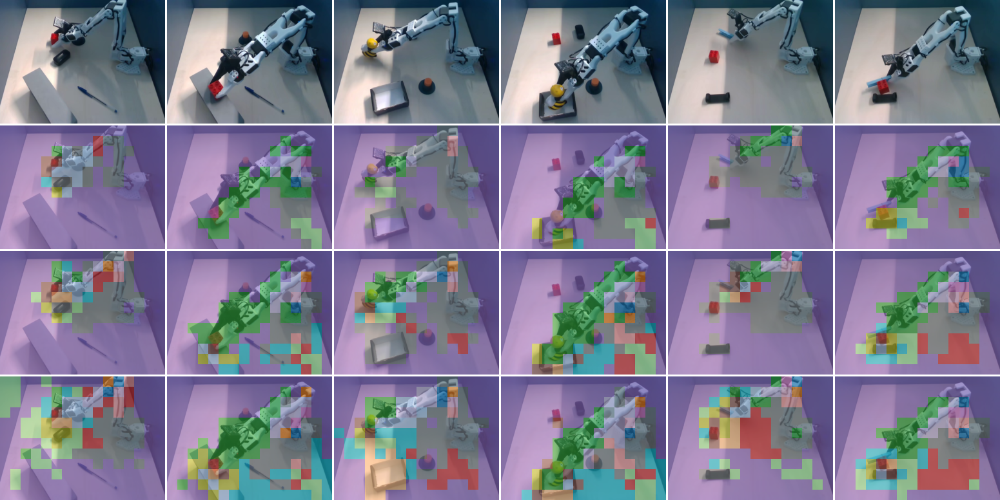
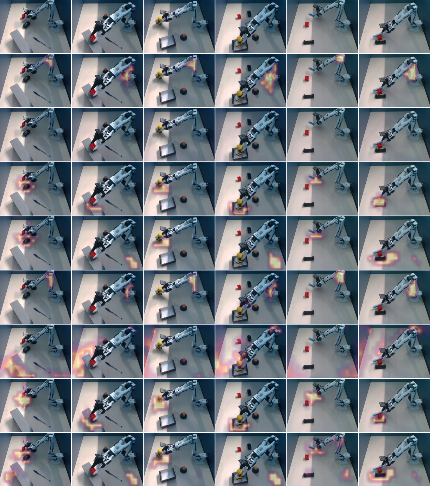
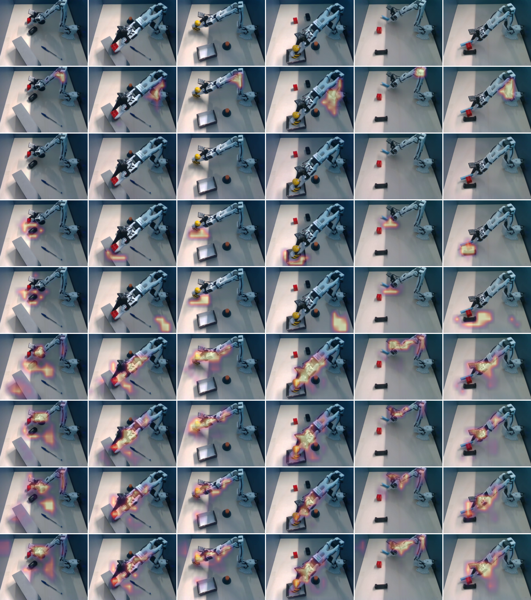
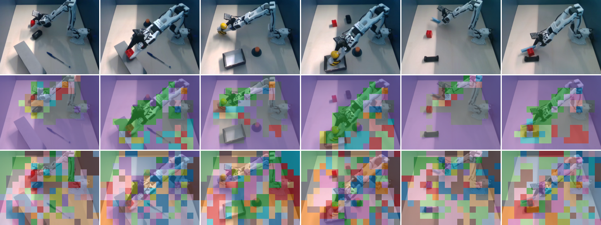
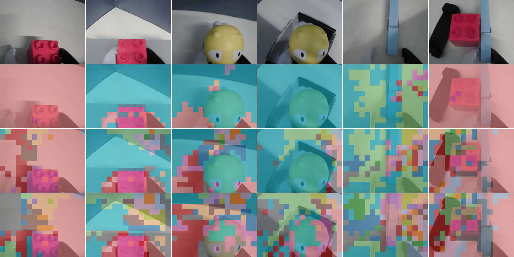
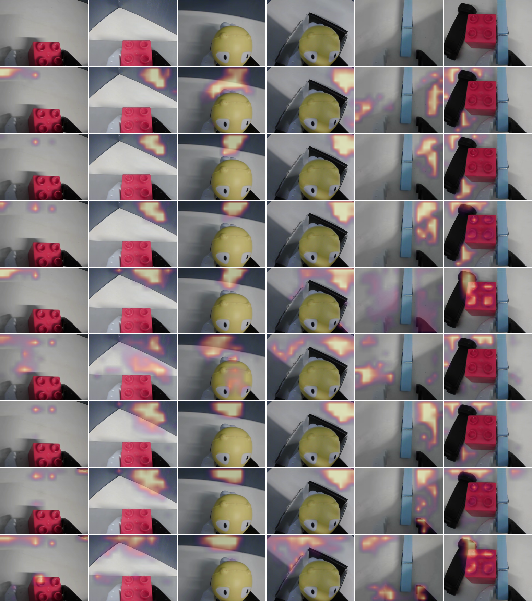
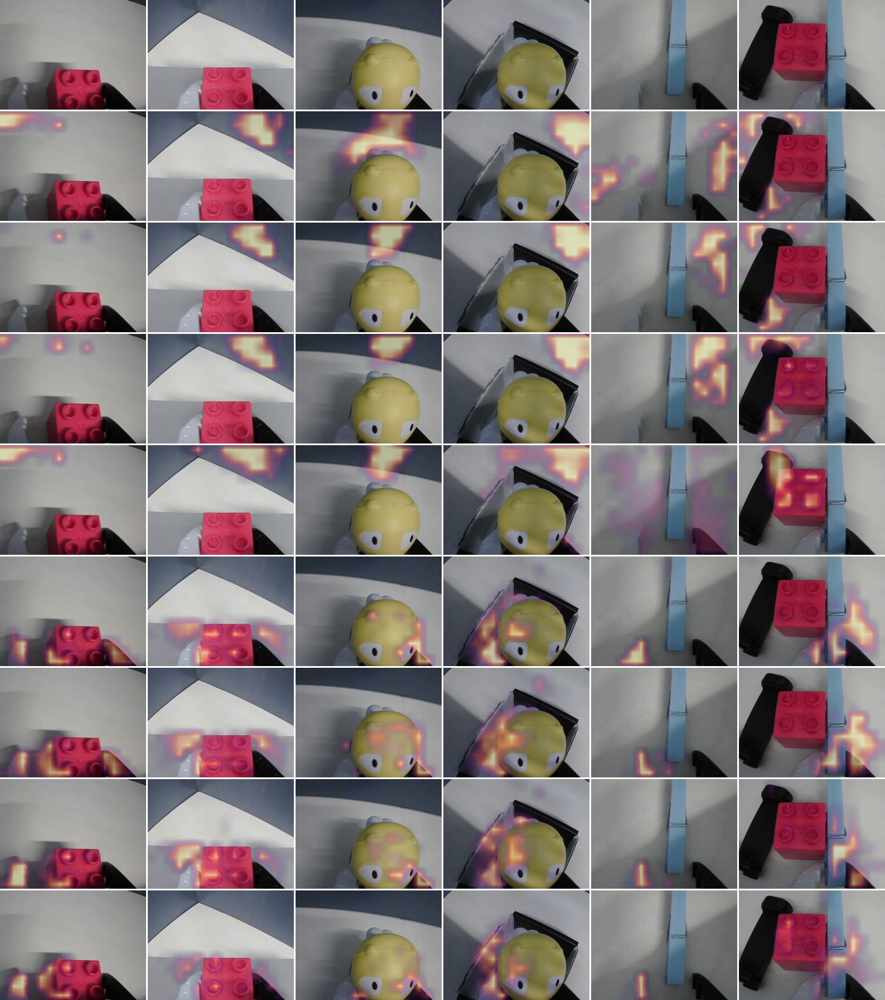
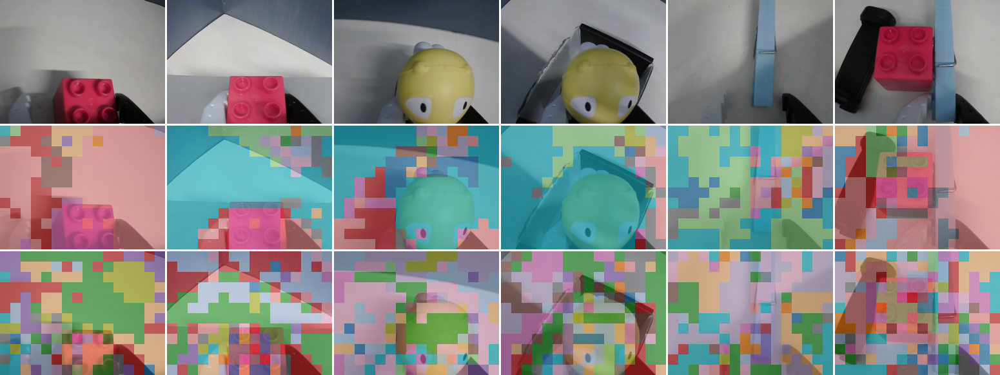

# Routing: confronto per l’appendice

[Metodo e limiti](README.md) · [Didascalie](CAPTIONS.md)

## front_normalization_winners

[PDF](clean/front_normalization_winners.pdf) · [Versione con etichette](labeled/front_normalization_winners.png)

## front_controlled_slot_maps

[PDF](clean/front_controlled_slot_maps.pdf) · [Versione con etichette](labeled/front_controlled_slot_maps.png)

## front_trained_models_slot_maps

[PDF](clean/front_trained_models_slot_maps.pdf) · [Versione con etichette](labeled/front_trained_models_slot_maps.png)

## front_trained_models_winners

[PDF](clean/front_trained_models_winners.pdf) · [Versione con etichette](labeled/front_trained_models_winners.png)

## wrist_normalization_winners

[PDF](clean/wrist_normalization_winners.pdf) · [Versione con etichette](labeled/wrist_normalization_winners.png)

## wrist_controlled_slot_maps

[PDF](clean/wrist_controlled_slot_maps.pdf) · [Versione con etichette](labeled/wrist_controlled_slot_maps.png)

## wrist_trained_models_slot_maps

[PDF](clean/wrist_trained_models_slot_maps.pdf) · [Versione con etichette](labeled/wrist_trained_models_slot_maps.png)

## wrist_trained_models_winners

[PDF](clean/wrist_trained_models_winners.pdf) · [Versione con etichette](labeled/wrist_trained_models_winners.png)

[Atlanti completi di tutti i 16 slot](all_slots/)